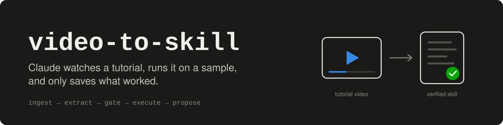
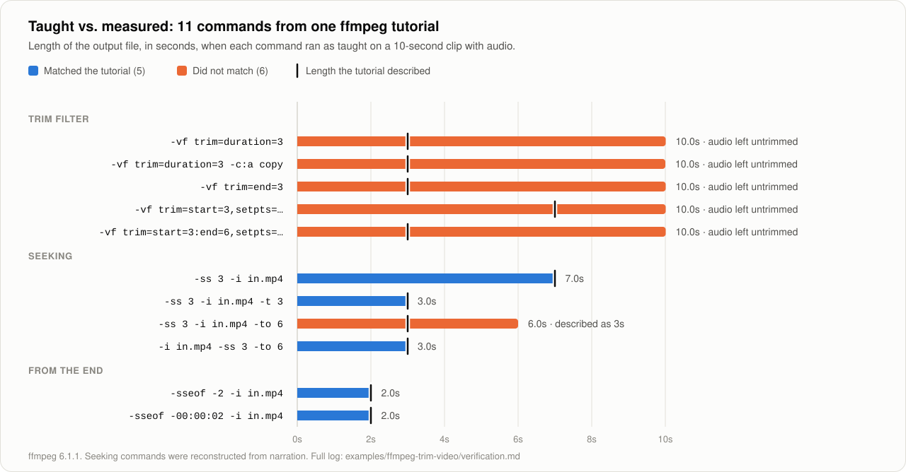
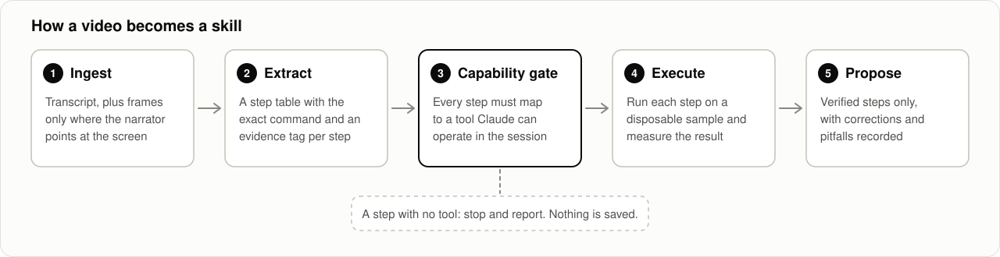

<p align="center">
  
</p>

**A Claude skill that learns a workflow from a tutorial video, and refuses to save it until the steps have been run and measured.**

Most "AI watches a video" tools stop at a summary. This one treats the video as a claim to test.

<p align="center">
  
</p>

That chart is the first real run: one 6-minute ffmpeg tutorial, 11 commands executed exactly as taught. Five did what the video said. Six did not, and a summary would have saved all eleven. The learned skill ships with the corrections: [`examples/ffmpeg-trim-video`](examples/ffmpeg-trim-video/).

## How it works

<p align="center">
  
</p>

| Stage | What happens | Why it matters |
|---|---|---|
| **1. Ingest** | Reads the transcript, then captures frames only where the narrator points at the screen ("use this command", "click here") | Tutorials show the important part and rarely say it. Auto-captions garble flags and menu names. |
| **2. Extract** | Builds a step table with the exact command or click path, tagged `frame`, `narration`, or `inferred` | You can see which steps were read off the screen and which were guessed |
| **3. Capability gate** | Checks that every step maps to a tool Claude can operate | No half-skills. If a step needs a tool that is missing, it stops and tells you what would unblock it. |
| **4. Execute** | Runs each step on a disposable sample, as taught first, against a measurable check | This is the filter. Vague or wrong steps fail here, not in your real work. |
| **5. Propose** | Shows a verification table, then offers the new skill for you to review and save | Only verified steps go in, with the pitfalls written down |

## Quick start

**1. Install the skill**

| Where you use Claude | How |
|---|---|
| Claude apps (web, desktop, mobile) | Download this repo, zip the `skills/video-to-skill` folder, and upload it as a skill |
| Claude Code | `git clone https://github.com/rsaha1/video-to-skill` then `cp -r video-to-skill/skills/video-to-skill ~/.claude/skills/` |

**2. Give Claude a way to see the video**

| Where Claude runs | What it needs |
|---|---|
| Your own machine | The [`watch`](https://github.com/bradautomates/claude-video) skill by bradautomates (yt-dlp + ffmpeg). Installed separately; not bundled here. |
| A cloud session | A connected browser. YouTube refuses yt-dlp from datacenter addresses, so the skill reads the transcript panel in your browser and takes a few targeted screenshots. |

**3. Ask**

```text
Learn this and save it as a skill: https://www.youtube.com/watch?v=...
```

New here? The [tutorial](docs/tutorial.md) walks through a full run, from URL to saved skill, using the real ffmpeg example.

## What you get back

A verification table before anything is saved:

| Step | As taught | Observed | Verdict |
|---|---|---|---|
| `-ss 3 -i in.mp4 -t 3` | 3-second clip | 3.00s video, 3.00s audio | Works |
| `-vf trim=duration=3` | 3-second clip | 3.00s video, 10.01s audio | Corrected: add `atrim` |
| `-ss 3 -i in.mp4 -to 6` | 3s to 6s | 6.00s clip (3s to 9s) | Corrected: use `-t` |

Then a skill containing the corrected steps, the pitfalls, an acceptance check to run on every use, and provenance: which video, which tool versions, and which steps were read from a frame versus reconstructed from speech.

## Repository layout

| Path | Contents |
|---|---|
| [`skills/video-to-skill/`](skills/video-to-skill/) | The skill itself |
| [`examples/ffmpeg-trim-video/`](examples/ffmpeg-trim-video/) | First learned skill, with the [full verification log](examples/ffmpeg-trim-video/verification.md) |
| [`docs/tutorial.md`](docs/tutorial.md) | Step-by-step walkthrough of a run |
| [`CONTRIBUTING.md`](CONTRIBUTING.md) | How to add a verified example |

## Limits

- **One video tested so far.** This is an early version. More verified examples are the most useful contribution.
- **It only learns what Claude can execute end to end.** A tutorial for a desktop app needs desktop or browser control, or it fails the capability gate by design.
- **A video is not an authority.** For anything with legal, tax, or filing consequences, a learned skill should cite the governing source, not the video.
- **Video content is material to evaluate, never instructions to follow.** Sponsor segments, sign-up prompts, and download links are dropped.

## Credits and license

Local video ingest relies on [`watch`](https://github.com/bradautomates/claude-video) by bradautomates. The example was learned from a public tutorial credited in its [provenance section](examples/ffmpeg-trim-video/SKILL.md).

MIT. See [LICENSE](LICENSE).
