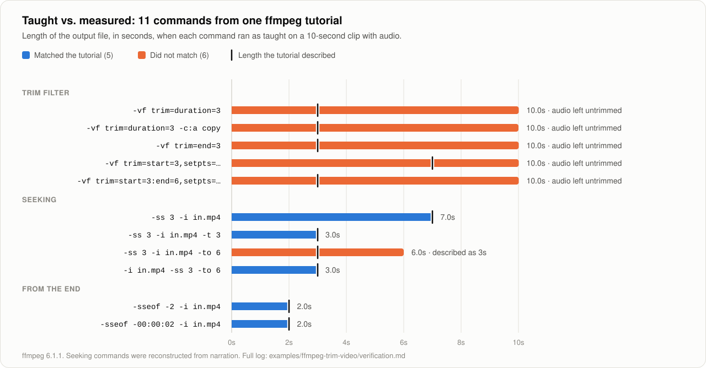

# Tutorial: your first video-to-skill run

This walks through one complete run, using the real example in this repository: a 6-minute tutorial on trimming video with ffmpeg. Every number below comes from that run. Expect about ten minutes.

**You need:** the skill installed ([Quick start](../README.md#quick-start)), a way for Claude to see the video, and a tutorial whose steps Claude can execute. Command-line, spreadsheet, and scripting tutorials are the best first picks.

## Step 1. Pick the right kind of video

| Good first video | Poor first video |
|---|---|
| Under 10 minutes | An hour-long course |
| One task, start to finish | A tour of many features |
| Steps Claude has tools for (shell, Python, spreadsheets, a browser) | A desktop app Claude cannot reach |
| A result you can measure (a duration, a total, a row count) | A result judged by eye |

## Step 2. Ask

```text
Learn this and save it as a skill: https://www.youtube.com/watch?v=jCJxgMjJ0xw
```

## Step 3. Ingest: transcript first, frames only where needed

Claude pulls the transcript, then looks for places where the narrator points at the screen without reading it out. In the example, the narration said "use this command" again and again and never spoke the command. Auto-captions also turned `-sseof` into "SS EOF" and `-c:a copy` into "ash c a copy".

So Claude captured a frame at those moments and read the commands off the screen. Expect 3 to 8 frames per video, not a scan of every second.

> **If you see "Sign in to confirm you're not a bot":** that is YouTube refusing a download from a cloud address. The skill does not try to get around it. It switches to reading the transcript panel in your connected browser.

## Step 4. Extract: the step table

Claude turns the video into rows. Each row carries an evidence tag so you know how far to trust it.

| # | Action | Exact command | Evidence |
|---|---|---|---|
| 1 | Keep the first 3 seconds | `ffmpeg -i in.mp4 -vf trim=duration=3 out.mp4` | `frame` |
| 2 | Cut from 3s to the end | `ffmpeg -ss 3 -i in.mp4 out.mp4` | `narration` |
| 3 | Keep the last 2 seconds | `ffmpeg -sseof -2 -i in.mp4 out.mp4` | `narration` |

- `frame`: read directly off the screen.
- `narration`: rebuilt from what was said. The creator's exact command may differ.
- `inferred`: the video skipped it and Claude filled the gap.

The example's closing segment promoted a paid product. It was dropped.

## Step 5. Capability gate

Claude names the tool for every row. Here that was simple: every step is an `ffmpeg` command and `ffmpeg` was installed.

If a row has no tool, the run stops at this point with a list of what is blocked and what would unblock it. Nothing is saved. That is the intended outcome for, say, a Premiere tutorial in a session with no desktop control.

## Step 6. Execute on a sample

Claude generated a 10-second test clip with an audio track, ran all 11 commands exactly as taught, and measured each output with `ffprobe`.



Two things surfaced that the video never mentions:

1. **The trim filter cut the video and left the audio alone.** Five commands produced 3 seconds of picture inside a 10-second file. The fix is a matching `atrim` on the audio.
2. **`-to` after input seeking is not an end time.** `-ss 3 -i in.mp4 -to 6` produced 6 seconds (3s to 9s), not 3s to 6s. That command was a `narration` row, so the on-screen original may have been different. The log says so.

Claude then ran the corrected commands and confirmed they produce matching video and audio lengths. The full log is in [`verification.md`](../examples/ffmpeg-trim-video/verification.md).

## Step 7. Review and save

You get the verification table first, then the proposed skill. Read three things before you save:

- **Verdicts.** Anything marked "corrected" is where the skill departs from the video.
- **Evidence tags.** Be more careful with `narration` and `inferred` rows.
- **The acceptance check.** This is what the skill will run every time it is used. For the example: video and audio durations must both match the intended length.

The saved result is [`examples/ffmpeg-trim-video/SKILL.md`](../examples/ffmpeg-trim-video/SKILL.md).

## Step 8. Use it

From then on, a plain request is enough:

```text
Cut the first 45 seconds off interview.mp4
```

Claude picks the right command from the learned skill, runs it on a copy, and runs the acceptance check before handing the file back.

## Troubleshooting

| Symptom | Cause | What to do |
|---|---|---|
| Run stops at the capability gate | A step needs a tool the session lacks | Connect the tool it names, or pick a different tutorial |
| No transcript found | The video has no captions | Use a local setup with the `watch` skill and a transcription key, or choose another video |
| Many rows tagged `narration` | The video shows steps too briefly to capture | Ask Claude to capture more frames around those timestamps |
| A step fails and no fix is found | The tutorial is wrong or out of date | Ask Claude to cross-check two more videos on the same task |
| Long video | Frame cost grows with length | Tell Claude which section matters |
